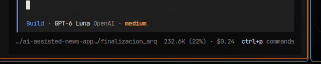

# Loop 08 — Implementación de arquitectura conversacional JEV + CODE + LLM

- Loop: `08-chat-architecture-implementation`.
- Fecha de implementación: 2026-10-17.
- Documento del loop: [08-chat-architecture-implementation.md](../08-chat-architecture-implementation.md).
- Handoff previo de planificación: [chat-architecture-roadmap-result.md](chat-architecture-roadmap-result.md).

## Objetivo y estado

Implementar las seis fases de `docs/architecture/chatbot-jev-code-llm-pendientes.md`
en el assistant de noticias, sin alterar el diseño aprobado de MongoDB.

**Estado: completado.** La interpretación de JEV fue confirmada por el usuario:
router interno determinista en Python, sin framework, servicio externo ni llamada
de IA para clasificar o enrutar.

## Cambios

- `backend/assistant/news_chat/capabilities.py`: catálogo cerrado, recursos y
  presentaciones registrados, matriz CODE/LLM y validación del catálogo.
- `backend/assistant/news_chat/routing.py`: contratos `BusinessContext` y
  `TurnState`; clasificación `OUT_OF_SCOPE`, `PARTIAL` y `BUSINESS`; limpieza de
  fragmentos fuera de alcance y selección determinista de capacidad.
- `backend/assistant/news_chat/service.py`: ejecución y presentación desde el
  catálogo. CODE cubre listados, detalle, búsqueda, conteos y grupos por país;
  LLM queda limitado a resumen y explicación. Los listados expresan cuando son
  una muestra. Las solicitudes fuera de alcance no consultan noticias ni IA.
- `backend/assistant/news_chat/intent.py` y `conversation.py`: routing de
  agrupación por país sobre citas previas y resolución del seguimiento demostrativo
  «¿y eso?» sin estado nuevo persistido.
- `backend/assistant/prompts/news.md`: limita al modelo a resumir/explicar los datos
  autorizados; el backend conserva el routing y las consultas.
- Tests unitarios de routing, ejecución CODE, manejo parcial, sesiones y costos;
  `tests/integration/test_news_shared_contract.py` verifica las rutas con MongoDB
  temporal.
- README y documentación de arquitectura actualizados; este handoff registra el
  resultado.

## Matriz y límites

| Ruta | Capacidad/ejecución |
| --- | --- |
| Noticias recientes, país, tema, detalle y búsqueda libre | CODE |
| Conteos y grupos por país | CODE |
| Resumen y explicación | LLM, si hay proveedor/precios/presupuesto válidos |
| Fuera de alcance | Plantilla; sin lectura de noticias ni llamada al modelo |
| Solicitud mixta | Atiende solo el fragmento de noticias y añade una nota fija |

La búsqueda libre existente se conserva como `news.search`, acotada a las 200
publicaciones recientes. Si no hay coincidencias, se usa `unsupported`. Los
recursos y presentaciones se seleccionan exclusivamente desde registros internos;
el texto del usuario o modelo no puede ejecutar código ni consultas arbitrarias.

No se añadieron capacidades ajenas a noticias, campos, enums, colecciones,
validadores, índices, TTL, telemetría o dependencias.

## Verificaciones

- `docker compose --profile test run --rm --no-deps --build -e ASSISTANT_BASE_URL= tests python -m pytest -q assistant/tests news/tests`
  - **337 passed, 2 skipped**. Se desactivó únicamente la variable del smoke test
    externo porque esta ejecución aislada no levanta el servicio chatbot.
- `make news-integration-test`
  - **1 passed** con MongoDB efímera en tmpfs y red interna. Probó bootstrap,
    fixtures, consultas, seguimiento, alcance parcial/fuera de dominio, esquema,
    índices, TTL e identidad admin. No usó Atlas, OpenAI, `keys/` ni datos locales.
- Ruff check sobre módulos y tests afectados: **All checks passed**.
- Ruff format check sobre módulos y tests afectados: **15 files already formatted**.
- `git diff --check`: correcto.
- Secret scan acotado: cero hallazgos en módulos, prompt y test nuevo. El test de
  integración reporta una regla `mongodb-uri` en una línea preexistente que arma
  una URI temporal a partir del nombre aleatorio del contenedor; no es una
  credencial. No se leyeron ni escanearon archivos dentro de `keys/`.

No se hicieron llamadas reales a OpenAI ni verificación contra Atlas. No se hizo
prueba visual del frontend: la arquitectura afecta el backend del chat.

## Coste del loop (telemetría OpenCode)

Captura archivada en [`backend/loops/images/loop-8-gpt-6-luna.png`](../images/loop-8-gpt-6-luna.png):

- Coste: **USD 0.24**.
- Uso visible: `232.6K (22%)`.
- Modelo indicado: **GPT-6 Luna (OpenAI), medium**.

Este dato corresponde al trabajo del agente/OpenCode, no al presupuesto funcional
de USD 20 ni a la colección `aiUsage` de AI News.

## Trazabilidad DB

- [x] Modelos revisados: sin cambios.
- [x] Documentación sincronizada; diseño DB vigente no requiere cambios.
- [x] Diagrama `docs/design/database/07-diagrama.md` revisado: sin cambio estructural.
- [x] Tests sincronizados: unitarios e integración efímera.
- [x] Makefile revisado: targets existentes bastan; sin cambios.
- [x] Secrets/bootstrap revisados: sin cambios; no se accedió a secretos.

## Git y cierre

- Commit: ninguno; no solicitado.
- Push: ninguno.
- Working tree: conserva los cambios de implementación, pruebas y documentación de
  esta tarea; no se alteró historia Git.
- Bloqueos: ninguno para el alcance acordado.
- Para usar el código en un proceso ya levantado, reconstruir/recrear el servicio
  `chatbot` con el flujo local habitual.

## Normalización documental (2026-10-17)

- Se asignó el número 08, continuación de los loops 00–07, y se añadió el documento
  del loop reconstruido desde este resultado; no es una nueva implementación.
- Handoff renombrado a `08-chat-architecture-implementation-result.md` y captura
  a `loop-8-gpt-6-luna.png`, conservando los bytes originales de la imagen.
- Se actualizaron los enlaces desde arquitectura y desde el handoff del loop 09.
- Se verificaron enlaces locales, integridad de imágenes y `git diff --check`.
  No se repitieron las suites históricas: esta normalización solo cambia documentación
  y nombres de archivos. Se aplicó `.skills/code-reviewer/SKILL.md` para revisar el cambio.
- Sin nuevas decisiones de DB ni bloqueos documentales. Modelos, diagrama, tests,
  Makefile y secrets/bootstrap no requieren cambios por esta normalización.
- Sin commit ni push. El índice Git preexistente se conserva; los renombres y
  documentos nuevos quedan en el working tree, pendientes de staging.
