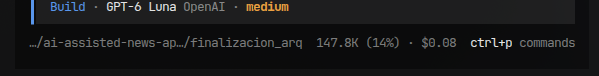

# Loop 09 — News Chat Context and UX — Result

## Objetivo y estado

- Loop: `09-news-chat-context-and-ux`.
- Documento del loop: [09-news-chat-context-and-ux.md](../09-news-chat-context-and-ux.md).
- Fecha: 2026-10-17.
- Estado: implementado y verificado; pendiente de validación visual/manual del usuario.
- Objetivo: al abrir el chat desde una noticia, iniciar una consulta que use esa noticia como
  contexto; mejorar el historial, el scroll y el envío con Enter.
- Handoffs leídos: `news-chat-integration-result.md`,
  `news-chat-conversation-context-result.md` y
  `08-chat-architecture-implementation-result.md`.
- Skills aplicadas: `systematic-debugging`, `test-driven-development`,
  `planning-with-files` y `code-reviewer`; guía UI consultada para responsive, teclado
  y accesibilidad.
- Plan temporal: `/tmp/opencode/news-chat-ux-loop-plan.md`.

## Causa y decisión

- El CTA «Preguntar al asistente» solo navegaba a `#/asistente/<slug>`; no enviaba un primer
  turno. Por eso el chat podía abrirse sin responder.
- El cliente ya enviaba `newsId` cuando había una noticia en contexto y el backend ya resuelve
  noticias publicadas por ese ID. Se conserva ese contrato: al abrir desde una noticia, el
  frontend envía automáticamente «Explícame esta noticia: <título>» junto con su `newsId`.
  El backend se valida con una regresión que confirma el ID atribuido y el título/contenido que
  llega al proveedor. No se amplía el esquema ni se cambia el routing existente.
- La pantalla guardaba un solo hilo local y mostraba mensajes sin un scroll interno. Se añade
  historial local por usuario, dentro de la misma vigencia de una hora definida para la sesión;
  no se cambia la política TTL de MongoDB.

## Cambios realizados

- `frontend/src/features/chat/ChatScreen.tsx`
  - Inicia automáticamente un chat contextual con la noticia seleccionada.
  - Presenta las conversaciones en un panel lateral en escritorio y en un panel desplegable
    en móviles; permite crear y cambiar de conversación.
  - Añade scroll vertical propio al hilo y baja al final al abrir una conversación o al añadir
    mensajes/respuestas.
  - Envía al presionar Enter; conserva el botón de envío.
  - Bloquea el composer durante la carga inicial del historial y durante envíos.
- `frontend/src/features/chat/chatHistory.ts` (nuevo): persistencia, migración del formato local
  de un único chat, títulos y filtrado por usuario/vigencia.
- `frontend/src/features/news/NewsFeedScreen.tsx`: evita envolver el chat en el scroll general de
  noticias, permitiendo que composer e hilo ocupen el alto disponible.
- `frontend/tests/chatHistory.test.ts` (nuevo): título/prompt, aislamiento por usuario, expiración
  y migración del almacenamiento anterior.
- `frontend/tests/chatService.test.ts`: verifica que el mensaje con el título y el `newsId` se
  envían juntos.
- `backend/assistant/tests/test_news_chat.py`: se amplía la prueba de noticia abierta para
  verificar que el backend atribuye el uso al `newsId` y envía el título/contexto al proveedor.
  **Este archivo ya estaba modificado antes del loop**; sus cambios preexistentes se conservaron.
- No se cambian modelos, colecciones, índices, validaciones, seeders, secretos ni dependencias.

## Verificación

- Red de TDD para `chatHistory.test.ts`: falló inicialmente por el helper aún inexistente;
  tras implementarlo, las cuatro pruebas nuevas pasaron.
- Frontend:
  - `npm run typecheck`: correcto.
  - `npm test`: **15 tests pasaron**.
  - `npx expo export --platform web --output-dir /tmp/opencode/news-chat-web-build`:
    bundle web exportado (2238 módulos).
- Backend aislado, sin Atlas ni llamadas reales a IA:
  - `docker compose --profile test run --rm --no-deps --build -e ASSISTANT_BASE_URL= tests python -m pytest -q assistant/tests news/tests`
  - **337 passed, 2 skipped**.
  - Ruff sobre `assistant/tests/test_news_chat.py`: correcto.
- `git diff --check`: correcto.
- El intento inicial de pytest con el Python local no pudo recolectar porque ese entorno no
  tiene el paquete `openai`; se usó la imagen de pruebas del repositorio y la suite pasó.
- El build web confirma compilación, pero no se realizó prueba visual en navegador ni dispositivo.

## Coste del loop (telemetría OpenCode)

Captura archivada en
[`backend/loops/images/loop-9-gpt-6-luna.png`](../images/loop-9-gpt-6-luna.png):

- Coste: **USD 0.08**.
- Uso visible: `147.8K (14%)`.
- Modelo indicado: **GPT-6 Luna (OpenAI), medium**.

Este dato corresponde al trabajo del agente/OpenCode, no al presupuesto funcional de USD 20 ni a
la colección `aiUsage` de AI News.

## Decisiones pendientes / bloqueos

- Ninguno para implementación o pruebas automatizadas.
- Validar manualmente el CTA desde una noticia, el panel en escritorio/móvil, scroll al último
  mensaje y envío con Enter. Con proveedor `stub`, la respuesta usa el contexto disponible sin
  llamada real a OpenAI.

## Trazabilidad de DB

- [x] Modelos revisados: sin cambios.
- [x] Documentación de diseño revisada: no requiere cambios, no cambia el comportamiento de DB.
- [x] Diagrama `docs/design/database/07-diagrama.md` revisado: sin cambio estructural.
- [x] Tests sincronizados: regresiones frontend y backend.
- [x] Makefile revisado: no requiere cambios.
- [x] Secrets/bootstrap revisados: sin cambios; no se accedió a `keys/`.

## Git y continuación

- Commit: ninguno. Push: ninguno.
- Staging al cerrar la implementación original: vacío; ver la actualización documental abajo.
- Se preservó el working tree preexistente. Antes de este loop ya estaban modificados
  `README.md`, documentación/README y prompt del assistant, `backend/assistant/news_chat/`
  (conversación, intent y service), varias pruebas del assistant, arquitectura y la prueba de
  integración compartida; también estaban sin seguimiento los archivos de routing/capabilities,
  sus pruebas, el handoff de arquitectura y su imagen. No se revirtieron ni se atribuyen a este
  loop. Se añadieron/cambiaron únicamente los archivos listados arriba.
- No se incluyeron secretos ni se consultó la base real.
- Para continuar: revisar este handoff, iniciar frontend y backend mediante el flujo local
  habitual y probar la noticia, el historial y Enter en escritorio y móvil.

## Normalización documental (2026-10-17)

- Se asignó el número 09, posterior al loop 08 de arquitectura, y se añadió el
  documento del loop reconstruido desde este resultado.
- Handoff renombrado a `09-news-chat-context-and-ux-result.md` y captura a
  `loop-9-gpt-6-luna.png`, conservando los bytes originales de la imagen.
- Se verificaron enlaces locales, integridad de imágenes y `git diff --check`.
  No se repitieron las suites históricas: esta normalización solo cambia documentación
  y nombres de archivos. Se aplicó `.skills/code-reviewer/SKILL.md` para revisar el cambio.
- Se mantiene pendiente la validación visual/manual descrita arriba. No se afirma
  haberla realizado ni se alteran los resultados históricos de pruebas o costes.
- Modelos, documentación de diseño DB, diagrama, tests, Makefile y secrets/bootstrap
  no requieren cambios por esta normalización.
- Sin commit ni push. El índice Git preexistente se conserva; los renombres y
  documentos nuevos quedan en el working tree, pendientes de staging.
