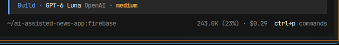

# Loop 11 — Feed personalizado, aprendizaje y diversidad

Fecha: 2026-10-18. Alcance: puntos 2–4 de `docs/reviews/alcance-pendiente-proyecto-2.md`.

## Objetivo y resultado

Implementados el feed personalizado (2), el aprendizaje de intereses (3) y la
composición/prominencia diversa (4), con Firebase UID como límite de identidad y
sin cambiar el esquema MongoDB. Las reglas de producto fueron aprobadas por el
usuario durante el loop y se documentaron en
`docs/design/database/03-criterios-de-personalizacion.md`.

## Cambios realizados

- `backend/news/personalization.py`: ranking determinista, desempates estables y
  reservas geográficas en posiciones 4 y 9.
- `backend/news/interactions.py`: registro secuencialmente idempotente de `opened`
  y `read`, actualización gradual de intereses y preservación del contexto inicial.
- `backend/news/api.py`: feed personalizado para identidades Firebase verificadas,
  lectura pública conservada, endpoints autenticados `GET/PATCH /profile` y
  `POST /news/{slug}/interactions/{opened|read}`.
- `frontend/src/services/newsService.ts`: perfil, envío de señales y orden del
  servidor sin reorden local.
- `frontend/src/features/news/NewsFeedScreen.tsx`: selección manual de país/temas,
  actualización del feed, prominencia en orden del servidor y medición de lectura
  con pausa al salir o ir a segundo plano.
- `frontend/src/features/chat/ChatScreen.tsx`: ubicación del chat leída/escrita en
  el mismo perfil Firebase/Mongo, eliminando el valor global de AsyncStorage.
- `frontend/src/components/ArticleCard.tsx`: motivo de selección visible y accesible.
- `frontend/src/features/news/readingProgress.ts`: cálculo determinista de progreso
  y tiempo activo.
- Pruebas nuevas/actualizadas en backend y frontend. `requirements-dev.txt` agrega
  `httpx2` porque la versión actual de Starlette/FastAPI requiere ese paquete para
  `TestClient`; el primer `make db-test` falló antes de instalarlo y la suite pasó
  luego de reconstruir la imagen de herramientas.
- `docs/design/database/03-criterios-de-personalizacion.md` y el alcance del review
  reflejan reglas y estado implementado.
- `backend/loops/images/loop-11-gpt-6-luna.png`: captura del coste de este loop,
  renombrada según la convención de las capturas de los loops anteriores; conserva
  los bytes de la imagen recibida.

## Decisiones aprobadas

- Ranking: +30 ubicación exacta; +10 alcance internacional si no hay coincidencia
  exacta; +20 por alguna coincidencia de temas declarados; hasta +20 por el mayor
  score inferido coincidente; hasta +20 por actualidad lineal a cero en 14 días.
  Orden por puntuación, fecha descendente e ID ascendente; el servidor puntúa todos
  los publicados antes de devolver como máximo 50.
- Aprendizaje: un registro por usuario/noticia/tipo; `opened` aporta +0.02 al llegar
  a 30 segundos activos; `read` aporta +0.08 al 90 %; cada tema de la noticia suma
  una vez y el score se limita a 1.0. Si el cuerpo completo cabe en el viewport,
  `read` requiere 5 segundos activos con al menos 90 % visible.
- Los puntajes se reconstruyen a partir del historial persistido; las señales reintentadas
  pueden reparar un fallo parcial de perfil. Esto recorre el historial del usuario por evento,
  aceptable para el volumen actual y sujeto a optimización si crece.
- Diversidad: posiciones 4 y 9 de las primeras 10 se reservan para noticias
  internacionales o de otra ubicación; falta de oferta se completa con el ranking.
- El motivo mostrado corresponde a la señal principal usada; una reserva explica
  que amplía la cobertura. No se añadió un campo de importancia ni otro cambio de DB.

## Pruebas y verificaciones ejecutadas

- `make db-test`: **231 passed**. Suite normal, sin Atlas ni credenciales reales.
- `cd frontend && npm run typecheck`: correcto.
- `cd frontend && npm test`: **21 passed**.
- `python -m compileall -q backend/news`: correcto.
- `python .skills/security-compliance/scripts/test_secret_scan.py`: **8 passed**.
- `secret_scan.py` sobre los módulos de API, personalización, interacción y
  frontend afectados: **0 hallazgos**.
- `git diff --check`: correcto.
- La prueba API cubre autenticación, aislamiento de perfiles, feed, contexto de
  apertura, reintentos y actualización de intereses. Las pruebas controladas cubren
  perfiles distintos, empates, foco temático, escasez, pausas y límites de score.

## Coste del loop (telemetría OpenCode)

Captura archivada en
[`backend/loops/images/loop-11-gpt-6-luna.png`](../images/loop-11-gpt-6-luna.png):

- Coste: **USD 0.29**.
- Uso visible: `243.0K (23%)`.
- Modelo indicado: **GPT-6 Luna (OpenAI), medium**.

Este dato corresponde al trabajo del agente/OpenCode, no al presupuesto funcional
de USD 20 ni a la colección `aiUsage` de AI News.

## Seguridad, datos y límites

- Perfil y señales se vinculan a la identidad Firebase verificada; el cliente no
  envía un `userId` para decidir qué cuenta modifica.
- Se valida ubicación activa y catálogo de temas en servidor. No se usa GPS.
- La deduplicación usa el índice compuesto existente, que **no es único**; protege
  reintentos secuenciales, no carreras concurrentes. Hacerla atómica requeriría una
  decisión explícita de cambio estructural/índice.
- El servidor carga todos los candidatos publicados antes de ordenar. Esto cumple
  la regla de recuperar candidatos pertinentes; conviene revisar paginación/consulta
  incremental si el volumen deja de ser el dataset pequeño actual.
- Queda revisión visual manual en viewport móvil y web, así como validación con
  cuentas Firebase reales. No se accedió a `keys/`, no se usaron datos/credenciales
  reales y no se ejecutó ninguna operación de base de datos.

## Trazabilidad DB

- [x] Modelos y esquema: revisados; no requieren cambios estructurales.
- [x] Documentación: actualizada en criterios de personalización y alcance.
- [x] Diagrama: revisado; no cambia porque no hay colecciones/campos/referencias nuevos.
- [x] Tests: sincronizados con ranking, perfiles, señales y diversidad.
- [x] Makefile: revisado; sin cambios de comandos. Se actualizó solo dependencia de tests.
- [x] Secrets/bootstrap: revisados; sin archivos secretos ni credenciales nuevas.
- Seeders e índices: revisados; no requieren cambios para esta política.

## Estado final

- Commit/push: ninguno.
- Working tree: conserva cambios previos del Loop 10 en `docs/README.md`, handoff
  Firebase, alcance y guía; este loop añadió cambios de implementación, tests,
  criterios y este handoff. No se descartó ni revirtió trabajo previo.
- Pendiente para cerrar visualmente el punto 4: ejecutar revisión manual en web y
  móvil y actualizar la casilla correspondiente del documento de alcance.
- Siguiente paso operativo: reconstruir/reiniciar API y frontend para probar el flujo
  con configuración Firebase real; mantener fuera de `aiUsage` el costo de este loop.
