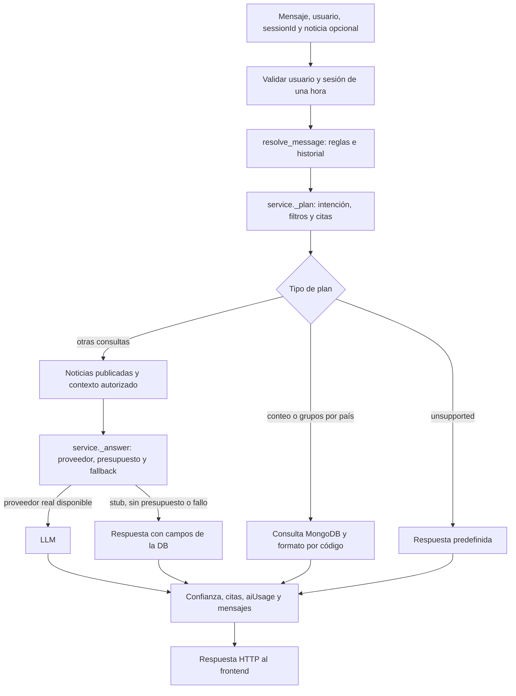
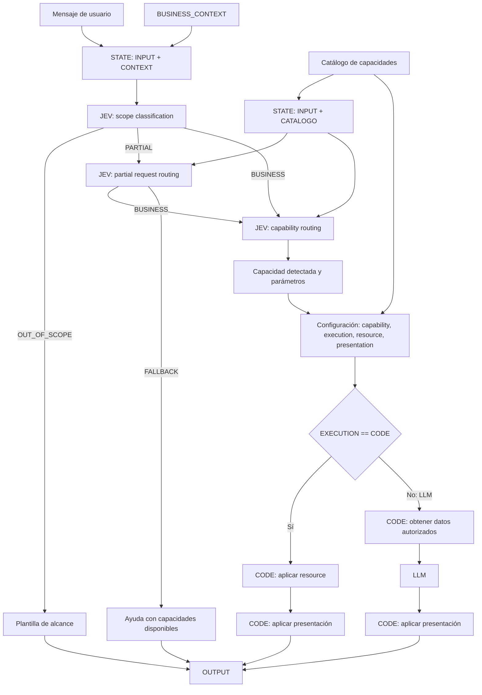

# Arquitectura pendiente del chat: JEV + CODE + LLM

Fecha de revisión: 2026-10-15. Estado: **plan de siguientes pasos; no implementado**.

El chat ya comparte DB, modelos y catálogos con AI News y puede consultar MongoDB
local o Atlas. Aún no implementa de forma completa el diagrama conversacional
JEV + CODE + LLM aportado por el usuario. Este documento identifica las piezas
existentes, las brechas y el orden propuesto para completarlo.

La autorización de este loop es documental. Los siguientes loops requieren su
instrucción de implementación; este documento no crea funcionalidades ni aprueba
cambios del esquema de MongoDB.

## Fuentes y alcance

- Diagrama aportado en la conversación: alcance `OUT_OF_SCOPE`, `PARTIAL` y
  `BUSINESS`; enrutamiento parcial; enrutamiento de capacidad; catálogo con
  `capability`, `execution`, `resource` y `presentation`; ejecución CODE o LLM.
- [Contrato implementado de noticias](contrato-compartido-noticias.md).
- [Diseño aprobado de DB](../design/database/README.md) y
  [criterios de chat y costos](../design/database/04-criterios-de-chat-y-costos.md).
- [Último handoff de contexto](../../backend/loops/handoffs/news-chat-conversation-context-result.md).

Los modelos, esquema y seeders aprobados en `4228506` siguen siendo la fuente de
verdad para los consumidores integrados desde `c756e4f`. La propuesta histórica de
`docs/architecture/README.md` no sustituye ese diseño.

**JEV se conserva como etiqueta del diagrama.** No se encontró un componente con
ese contrato en `backend/assistant/news_chat/`; no se presupone qué motor,
biblioteca o servicio representa. Esa elección se resuelve antes de implementar
los routers, sin introducir una dependencia externa automáticamente.

## Punto de partida verificado

- API y chat reutilizan `news.config`, `news.models`, los 14 topics y `locations`.
- El usuario confirmó el funcionamiento local y luego el uso de Atlas desde su PC.
  La salida compartida de `make db-verify` en Atlas fue OK: esquema, 16 países y
  32 fixtures demo. También confirmó las respuestas de conteo y países.
- El dataset canónico contiene 28 publicaciones y cuatro borradores. El total no
  está fijado en el chat: consulta la colección actual. La DB local conservaba
  además cinco demos históricas; esa diferencia no debe ocultarse ni borrarse.
- Conteos y agrupación por país ya usan `database_query`, sin IA. El resto de los
  listados todavía puede utilizar LLM cuando el proveedor real está habilitado.
- El contexto LLM incluye inventario real, alcance de la muestra y ubicaciones
  resueltas. El prompt vigente es `news-v3`.
- `chatSessions.messages` conserva la conversación durante 3600 segundos.
  `conversation.py` resuelve seguimientos y el proveedor recibe los últimos diez
  mensajes. No hay memoria entre sesiones ni almacenamiento de la conversación en OpenAI.
- La última implementación registró 311 pruebas backend aprobadas y una integración
  con MongoDB temporal. Son resultados del loop anterior, no pruebas nuevas de este documento.

Usar Atlas desde la PC no equivale a publicar la aplicación en internet. El despliegue
público y la autenticación definitiva quedan fuera de esta secuencia del diagrama.

## Flujo actual

El nodo de metadatos registra `aiUsage` únicamente cuando corresponde a una
llamada real; no representa un registro de consumo para CODE, stub o template.
Este flujo describe lo implementado, no la arquitectura objetivo.

## Brechas frente al diagrama

| Bloque del diagrama | Estado actual | Pendiente concreto |
| --- | --- | --- |
| `STATE: INPUT + CONTEXT` | Parcial: request, usuario, sesión y contexto se construyen en varios puntos. | Contrato interno común para el turno, con procedencia de datos y límites de memoria explícitos. |
| `BUSINESS_CONTEXT` | Dominio distribuido entre prompt, constantes y reglas. | Contexto de negocio común para clasificación, routing y presentación. |
| JEV: scope classification | `unsupported` cubre algunos rechazos, sin estado de alcance separado. | Resultado explícito `OUT_OF_SCOPE`, `PARTIAL` o `BUSINESS`. |
| Rama `OUT_OF_SCOPE` | Existe plantilla fuera de dominio. | Llegar a ella desde el clasificador de alcance, conservando la intención persistida `unsupported`. |
| JEV: partial request routing | No existe descomposición explícita de una petición mixta. | Separar parte atendible de la ajena al dominio y decidir negocio o fallback. |
| Fallback de petición parcial | Hay sugerencias y aclaraciones en texto. | Ayuda coherente con las capacidades realmente disponibles en el catálogo. |
| `STATE: INPUT + CATALOGO` | El catálogo de topics existe; no es un catálogo de capacidades. | Dar el mismo catálogo de capacidades a los dos routers y a la configuración. |
| JEV: capability routing | Reglas producen `ResponseIntent` y banderas en `ClassifiedQuery`. | Seleccionar una capacidad identificable, con parámetros y validación contra el catálogo. |
| Configuración de capacidad | No existe registro común. | Definir `capability`, `execution`, `resource` y `presentation` por capacidad. |
| `EXECUTION == CODE` | Conteos/grupos están forzados a CODE; otras decisiones dependen del proveedor. | Hacer que el modo de ejecución provenga de la capacidad. El proveedor no debe convertir una consulta CODE en LLM. |
| CODE: aplicar resource | Hay consultas PyMongo y helpers. | Exponerlos como handlers conocidos y reutilizables, sin aceptar consultas arbitrarias. |
| CODE: obtener datos → LLM | Existe retrieval, contexto, proveedor y control de presupuesto. | Invocarlos solo para capacidades LLM y con el contrato de datos de esa capacidad. |
| CODE: aplicar presentación | Hay `format_listing`, `format_detail` y metadatos en el servicio. | Presentación seleccionada por catálogo y ensamblado común para ambas ramas. |
| Conversación y oferta anterior | Seguimientos resueltos con reglas e historial. | Integrarlos con la capacidad y aclaración elegidas, conservando las regresiones existentes. |
| Pruebas del flujo completo | Hay pruebas de comportamientos, DB y continuidad. | Verificar los nodos/rutas del diagrama y la decisión de ejecución, no solo el texto final. |

No basta con modificar el prompt: alcance, capacidad, consultas y ejecución
necesitan contratos verificables en el backend.

## Flujo objetivo de los siguientes loops

Las validaciones de catálogo/parámetros, las aclaraciones, el presupuesto y la
persistencia del turno acompañan el flujo. No se dibujan como nuevas capacidades
ni autorizan al modelo a consultar MongoDB directamente. Una capacidad desconocida
debe producir fallback o aclaración, nunca ejecutar un handler arbitrario.

## Propuesta inicial del catálogo

Los siguientes identificadores son **propuestos**, todavía no contratos implementados.
Reutilizan comportamientos existentes; no añaden funcionalidades al producto.

| Capacidad propuesta | Intención persistida existente | Ejecución propuesta | Resource existente o base para el handler |
| --- | --- | --- | --- |
| `news.list_recent` | `recent_news` | CODE | `published_news_matching` |
| `news.list_by_country` | `regional_news` | CODE | `locations` + filtros geográficos |
| `news.list_by_topic` | `topic_news` | CODE | `news.topics` + filtros de topics |
| `news.detail` | `news_detail` | CODE | `find_published_news` |
| `news.count` | `recent_news`, `regional_news` o `topic_news`, según filtros | CODE | `count_news` |
| `news.group_by_country` | `regional_news` | CODE | Catálogo y conteos de publicaciones por país |
| `news.summarize` | `summarize` | LLM | Selección de publicaciones y contexto autorizado |
| `news.explain` | `explain` | LLM | Publicaciones/citas del turno y contexto autorizado |

`presentation` referenciaría un formateador registrado, no código recibido del modelo.
El rechazo y la ayuda de fallback usarían plantillas derivadas del catálogo.
La estructura mínima puede vivir versionada en código del modo news; **no se
propone una colección MongoDB nueva**. Su ubicación y formato se concretan en el primer loop.

No incluir búsquedas por autor, publicación de noticias, NOVU, transferencias,
ingesta ni filtros nuevos solo porque aparezcan en una sugerencia del modelo.
Cada ampliación requiere definición y autorización independientes.

## Orden de implementación propuesto

### 1. Contratos del turno y catálogo

Loop sugerido: `chat-capability-contracts`.

- Definir el estado interno del turno, `BUSINESS_CONTEXT`, configuración de
  capacidad y resultado de routing, separados de los modelos persistidos.
- Acordar la interpretación de JEV y la matriz CODE/LLM antes de conectarlos al servicio.
- Registrar handlers y presentaciones existentes con nombres estables y validados.
- Mantener la correspondencia con los enums actuales de `news.models`.
- Aceptación: catálogo sin duplicados, recursos/presentaciones registrados y ninguna
  capacidad con configuración incompleta. Modelos, schema y seeders siguen intactos.

### 2. Clasificación de alcance

Loop sugerido: `chat-scope-routing`; depende del anterior.

- Producir los tres resultados del diagrama antes del routing de capacidad.
- Distinguir una solicitud ajena al dominio de una solicitud válida sin resultados.
- Usar el contexto de sesión para no rechazar «ok sí hazlo» por ausencia de palabras clave.
- Aceptación: fixtures para las tres ramas; `OUT_OF_SCOPE` llega a la plantilla y
  no consulta artículos ni llama al generador. Persistir el turno sigue permitido.
- Si el motor JEV elegido requiere IA incluso para rechazos, resolver antes el
  conflicto con el diseño aprobado de `unsupported` sin consumo de IA.

### 3. Peticiones parciales y fallback

Loop sugerido: `chat-partial-routing`; depende de alcance y catálogo.

- Identificar qué fragmento de una petición mixta pertenece a noticias.
- Enrutar la parte atendible a negocio y explicar brevemente la parte no atendible.
- Si no queda una petición ejecutable, devolver ayuda basada en el catálogo.
- Una ambigüedad de parámetros necesita aclaración; no se debe confundir siempre
  con una petición parcialmente fuera de dominio.
- Aceptación: «noticias de México y haz una transferencia» solo puede atender la
  consulta de noticias; ninguna ruta debe llamar a NOVU o inventar esa capacidad.

### 4. Routing de capacidad y parámetros

Loop sugerido: `chat-capability-routing`; depende de los tres anteriores.

- Resolver una capacidad del catálogo desde el estado del turno y validar su salida.
- Asociar filtros, noticia seleccionada, ordinales y referencias previas a parámetros
  conocidos; solicitar aclaración cuando falte una elección necesaria.
- Una oferta única aceptada debe conservar su acción; una oferta con alternativas
  debe pedir cuál se elige. No inferir país ni noticia arbitrariamente.
- Aceptación: capacidad desconocida, parámetros inválidos o ambigüedad producen
  aclaración/fallback; no se invoca un resource hasta validar la selección.

### 5. Dispatcher CODE/LLM y presentación común

Loop sugerido: `chat-capability-execution`; depende del catálogo y routing.

- Sustituir decisiones dispersas por un dispatcher basado en `execution`.
- CODE aplica el resource registrado y su presentación; LLM obtiene datos mediante
  código, comprueba presupuesto, genera y aplica su presentación.
- Adaptar consultas, contexto y formatos existentes; no crear otra DB o esquema.
- Mantener citas, verificación, confianza y mensajes como responsabilidad del backend.
- Aceptación: con OpenAI configurado, las capacidades CODE siguen sin llamadas ni
  consumo de IA. Las capacidades LLM usan datos autorizados y conservan el registro
  de consumo. Stub, presupuesto agotado y fallos tienen una respuesta definida.

### 6. Integración del flujo completo con memoria y verificación

Loop sugerido: `chat-architecture-verification`; depende de las cinco fases.

- Integrar el nuevo flujo con `chatSessions.messages` y las reglas de sesión actuales.
- Probar las rutas del diagrama de extremo a extremo con proveedores falsos y MongoDB
  temporal; añadir regresiones en cada fase, no esperar a este loop para escribir tests.
- Permitir observar en pruebas alcance → routing parcial → capacidad → ejecución →
  presentación, sin registrar secretos ni el contenido completo de conversaciones reales.
- Sincronizar documentación, prompt, comandos Make y handoff con el flujo implementado.
- Aceptación: suite normal sin Atlas ni keys, comandos repetibles y una prueba manual
  equivalente para MongoDB local y Atlas. Atlas queda separado de los tests normales.

## Decisiones que deben quedar explícitas antes de implementar

| Decisión | Propuesta o límite para el siguiente loop |
| --- | --- |
| Qué representa JEV y dónde se ejecuta | Resolverlo con el propietario del diagrama; no asumir un framework o proveedor. |
| Ubicación y formato del catálogo | Preferir un registro versionado en código del modo news; no crear DB/ODM nuevos. |
| Matriz de ejecución | Revisar la tabla propuesta, especialmente sacar los listados puramente informativos del LLM. |
| Semántica de PARTIAL y ambigüedad | Definir ejemplos y salidas antes de implementar heurísticas. |
| Memoria de una acción ofrecida | Reutilizar mensajes/metadatos actuales; si se requiere persistir estado nuevo, pedir decisión de DB y actualizar su diseño primero. |
| Trazas del nuevo routing | Contratos internos y diagnósticos de prueba; añadir campos persistidos o telemetría de producción requiere diseño explícito. |
| Uso de IA para clasificación/routing | Cualquier llamada real cuenta para el presupuesto y debe ser compatible con los criterios aprobados de `aiUsage`. No confundirla con trabajo del agente. |

## Restricciones que todos los loops deben preservar

- `ai_assisted_news` independiente del assistant histórico y NOVU; mismo dominio en local y Atlas.
- Siete colecciones, modelos, índices, TTL y seeders aprobados, sin cambios implícitos.
- Solo citar contenido `published`; conteos de borradores no exponen su contenido.
- Totales calculados en MongoDB, separados de muestras de cinco y de la ventana de búsqueda libre de 200.
- Catálogo de países y topics compartido; referencias geográficas resueltas sin GPS ni deducciones del modelo.
- Sesión de 3600 segundos, del mismo usuario y sin recuerdos entre sesiones.
- Envío actual de hasta diez mensajes al LLM; cambiar la política necesita una decisión y pruebas, no una promesa de memoria ilimitada.
- Presupuesto funcional USD 20, uso real trazable y tokens no inventados.
- Secretos solo en `keys/`, nunca en prompts, `.env`, logs o handoffs; no leerlos en trabajo del agente.
- Sin drops, limpieza de datos o reseeds automáticos; las demos históricas no se eliminan para hacer pasar checks.

## Criterios de cierre de la arquitectura

- [ ] Cada bloque y transición del diagrama tiene un contrato y pruebas identificables.
- [ ] Alcance, petición parcial y selección de capacidad son etapas separadas.
- [ ] Routers y configuración utilizan el mismo catálogo; la ayuda no promete capacidades inexistentes.
- [ ] `execution`, `resource` y `presentation` determinan la ruta, con validación antes de ejecutar.
- [ ] Las dos ramas aplican presentación por código y generan metadatos coherentes con la ejecución real.
- [ ] «De qué países son», «resúmelas», «y de México», ordinales y aceptaciones conservan su selección o piden aclaración.
- [ ] Sigue siendo posible probar CODE sin credenciales y LLM con proveedores falsos.
- [ ] Esquema/modelos/seeders permanecen sincronizados con el diseño aprobado.
- [ ] Se documenta qué rutas pasaron pruebas automáticas y cuáles validó manualmente el usuario.
- [ ] La documentación deja de marcar el objetivo como pendiente solo después de verificar esas condiciones.

**Próximo paso recomendado:** comenzar por `chat-capability-contracts`, definiendo
el contrato del estado y el catálogo. La conexión a Atlas ya funciona; no es
necesario reconstruir la infraestructura de DB para iniciar ese trabajo.
