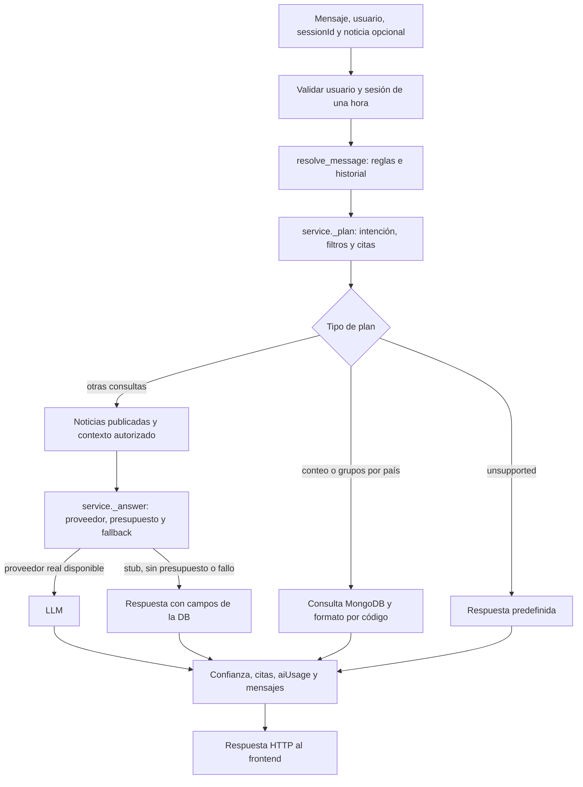
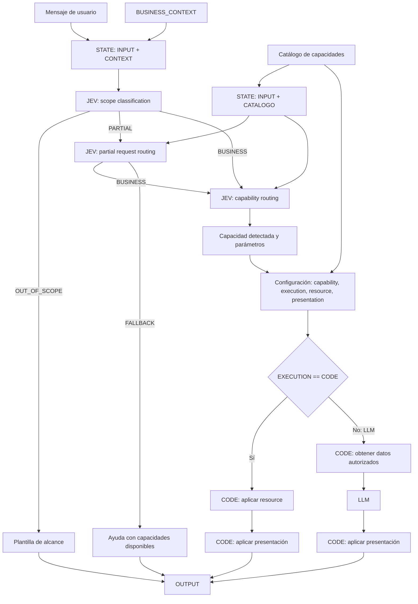

# Arquitectura conversacional del chat: JEV + CODE + LLM

Fecha de revisión: 2026-10-17. Estado: **implementado y verificado**.

El chat comparte DB, modelos y catálogos con AI News y consulta MongoDB local o
Atlas. Las seis fases de esta arquitectura están implementadas en modo news. Por
decisión del usuario, JEV se implementa como routers internos deterministas en
Python: no se agregó framework, servicio ni llamada de IA para clasificar o enrutar.

La implementación no modifica el esquema, colecciones, índices, seeders, TTL ni
contrato HTTP persistido. Las secciones que describen el baseline y las brechas
se refieren al estado previo al loop del 2026-10-17.

## Fuentes y alcance

- Diagrama aportado en la conversación: alcance `OUT_OF_SCOPE`, `PARTIAL` y
  `BUSINESS`; enrutamiento parcial; enrutamiento de capacidad; catálogo con
  `capability`, `execution`, `resource` y `presentation`; ejecución CODE o LLM.
- Decisión del usuario (2026-10-17): JEV es un router interno determinista, sin
  dependencia o proveedor externo.
- [Contrato implementado de noticias](contrato-compartido-noticias.md).
- [Diseño aprobado de DB](../design/database/README.md) y
  [criterios de chat y costos](../design/database/04-criterios-de-chat-y-costos.md).
- [Último handoff de contexto](../../backend/loops/handoffs/news-chat-conversation-context-result.md).

Los modelos, esquema y seeders aprobados en `4228506` siguen siendo la fuente de
verdad para los consumidores integrados desde `c756e4f`. La propuesta histórica de
`docs/architecture/README.md` no sustituye ese diseño.

**JEV** se conserva como etiqueta del diagrama y se materializa con
`backend/assistant/news_chat/routing.py`. El alcance, las solicitudes parciales y
las capacidades se resuelven con reglas controladas y pruebas; el catálogo es
cerrado y ningún texto de usuario/modelo selecciona código arbitrario.

## Estado previo a la implementación (2026-10-15)

- API y chat reutilizan `news.config`, `news.models`, los 14 topics y `locations`.
- El usuario confirmó el funcionamiento local y luego el uso de Atlas desde su PC.
  La salida compartida de `make db-verify` en Atlas fue OK: esquema, 16 países y
  32 fixtures demo. También confirmó las respuestas de conteo y países.
- El dataset canónico contiene 28 publicaciones y cuatro borradores. El total no
  está fijado en el chat: consulta la colección actual. La DB local conservaba
  además cinco demos históricas; esa diferencia no debe ocultarse ni borrarse.
- Conteos y agrupación por país ya usan `database_query`, sin IA. El resto de los
  listados todavía puede utilizar LLM cuando el proveedor real está habilitado.
- El contexto LLM incluye inventario real, alcance de la muestra y ubicaciones
  resueltas. El prompt vigente es `news-v3`.
- `chatSessions.messages` conserva la conversación durante 3600 segundos.
  `conversation.py` resuelve seguimientos y el proveedor recibe los últimos diez
  mensajes. No hay memoria entre sesiones ni almacenamiento de la conversación en OpenAI.
- La última implementación registró 311 pruebas backend aprobadas y una integración
  con MongoDB temporal. Son resultados del loop anterior, no pruebas nuevas de este documento.

Usar Atlas desde la PC no equivale a publicar la aplicación en internet. El despliegue
público y la autenticación definitiva quedan fuera de esta secuencia del diagrama.

## Flujo previo a la implementación (2026-10-15)

Este diagrama describe el baseline antes del loop, no el flujo vigente. Incluso en
este baseline, `aiUsage` solo se registraba por llamadas reales a IA.

## Brechas detectadas antes de implementar

| Bloque del diagrama | Estado en baseline | Trabajo requerido en ese momento |
| --- | --- | --- |
| `STATE: INPUT + CONTEXT` | Parcial: request, usuario, sesión y contexto se construyen en varios puntos. | Contrato interno común para el turno, con procedencia de datos y límites de memoria explícitos. |
| `BUSINESS_CONTEXT` | Dominio distribuido entre prompt, constantes y reglas. | Contexto de negocio común para clasificación, routing y presentación. |
| JEV: scope classification | `unsupported` cubre algunos rechazos, sin estado de alcance separado. | Resultado explícito `OUT_OF_SCOPE`, `PARTIAL` o `BUSINESS`. |
| Rama `OUT_OF_SCOPE` | Existe plantilla fuera de dominio. | Llegar a ella desde el clasificador de alcance, conservando la intención persistida `unsupported`. |
| JEV: partial request routing | No existe descomposición explícita de una petición mixta. | Separar parte atendible de la ajena al dominio y decidir negocio o fallback. |
| Fallback de petición parcial | Hay sugerencias y aclaraciones en texto. | Ayuda coherente con las capacidades realmente disponibles en el catálogo. |
| `STATE: INPUT + CATALOGO` | El catálogo de topics existe; no es un catálogo de capacidades. | Dar el mismo catálogo de capacidades a los dos routers y a la configuración. |
| JEV: capability routing | Reglas producen `ResponseIntent` y banderas en `ClassifiedQuery`. | Seleccionar una capacidad identificable, con parámetros y validación contra el catálogo. |
| Configuración de capacidad | No existe registro común. | Definir `capability`, `execution`, `resource` y `presentation` por capacidad. |
| `EXECUTION == CODE` | Conteos/grupos están forzados a CODE; otras decisiones dependen del proveedor. | Hacer que el modo de ejecución provenga de la capacidad. El proveedor no debe convertir una consulta CODE en LLM. |
| CODE: aplicar resource | Hay consultas PyMongo y helpers. | Exponerlos como handlers conocidos y reutilizables, sin aceptar consultas arbitrarias. |
| CODE: obtener datos → LLM | Existe retrieval, contexto, proveedor y control de presupuesto. | Invocarlos solo para capacidades LLM y con el contrato de datos de esa capacidad. |
| CODE: aplicar presentación | Hay `format_listing`, `format_detail` y metadatos en el servicio. | Presentación seleccionada por catálogo y ensamblado común para ambas ramas. |
| Conversación y oferta anterior | Seguimientos resueltos con reglas e historial. | Integrarlos con la capacidad y aclaración elegidas, conservando las regresiones existentes. |
| Pruebas del flujo completo | Hay pruebas de comportamientos, DB y continuidad. | Verificar los nodos/rutas del diagrama y la decisión de ejecución, no solo el texto final. |

No bastaba con modificar el prompt: alcance, capacidad, consultas y ejecución
necesitaban contratos verificables en el backend. La resolución implementada se
describe a continuación; esta tabla conserva el diagnóstico histórico.

## Flujo implementado

Las validaciones de catálogo/parámetros, las aclaraciones, el presupuesto y la
persistencia del turno acompañan el flujo. No se dibujan como nuevas capacidades
ni autorizan al modelo a consultar MongoDB directamente. Una capacidad desconocida
debe producir fallback o aclaración, nunca ejecutar un handler arbitrario.

## Catálogo implementado

El catálogo versionado en código reutiliza el comportamiento existente; no añade
funcionalidades al producto. `news.search` conserva la búsqueda libre existente.

| Capacidad | Intención persistida existente | Ejecución | Resource registrado | Presentación |
| --- | --- | --- | --- | --- |
| `news.list_recent` | `recent_news` | CODE | `recent_published_news` | `listing` |
| `news.list_by_country` | `regional_news` | CODE | `published_news_matching` | `listing` |
| `news.list_by_topic` | `topic_news` | CODE | `published_news_matching` | `listing` |
| `news.detail` | `news_detail` | CODE | `find_published_news` | `detail` |
| `news.count` | `recent_news`, `regional_news` o `topic_news`, según filtros | CODE | `count_news` | `count` |
| `news.group_by_country` | `regional_news` | CODE | `group_news_by_country` | `country_groups` |
| `news.summarize` | `summarize` | LLM | `published_news_context` | `summary` |
| `news.explain` | `explain` | LLM | `published_news_context` | `explanation` |
| `news.search` | sin enum nuevo; intención derivada del resultado | CODE | `search_published_news` | `search` |

`presentation` referencia una presentación registrada, no código recibido del
modelo. El rechazo usa plantilla y las peticiones parciales añaden una nota fija
al resultado atendible. El catálogo y los routers viven versionados en el modo
news; no hay colección nueva.

No incluir búsquedas por autor, publicación de noticias, NOVU, transferencias,
ingesta ni filtros nuevos solo porque aparezcan en una sugerencia del modelo.
Cada ampliación requiere definición y autorización independientes.

## Fases implementadas

### 1. Contratos del turno y catálogo

Fase `chat-capability-contracts`.

- Definir el estado interno del turno, `BUSINESS_CONTEXT`, configuración de
  capacidad y resultado de routing, separados de los modelos persistidos.
- JEV quedó acordado como routing interno determinista y la matriz CODE/LLM quedó registrada en el catálogo.
- Registrar handlers y presentaciones existentes con nombres estables y validados.
- Mantener la correspondencia con los enums actuales de `news.models`.
- Aceptación: catálogo sin duplicados, recursos/presentaciones registrados y ninguna
  capacidad con configuración incompleta. Modelos, schema y seeders siguen intactos.

### 2. Clasificación de alcance

Fase `chat-scope-routing`; depende de los contratos.

- Producir los tres resultados del diagrama antes del routing de capacidad.
- Distinguir una solicitud ajena al dominio de una solicitud válida sin resultados.
- Usar el contexto de sesión para no rechazar «ok sí hazlo» por ausencia de palabras clave.
- Aceptación: fixtures para las tres ramas; `OUT_OF_SCOPE` llega a la plantilla y
  no consulta artículos ni llama al generador. Persistir el turno sigue permitido.
- Si el motor JEV elegido requiere IA incluso para rechazos, resolver antes el
  conflicto con el diseño aprobado de `unsupported` sin consumo de IA.

### 3. Peticiones parciales y fallback

Fase `chat-partial-routing`; depende de alcance y catálogo.

- Identificar qué fragmento de una petición mixta pertenece a noticias.
- Enrutar la parte atendible a negocio y explicar brevemente la parte no atendible.
- Si no queda una petición ejecutable, devolver ayuda basada en el catálogo.
- Una ambigüedad de parámetros necesita aclaración; no se debe confundir siempre
  con una petición parcialmente fuera de dominio.
- Aceptación: «noticias de México y haz una transferencia» solo puede atender la
  consulta de noticias; ninguna ruta debe llamar a NOVU o inventar esa capacidad.

### 4. Routing de capacidad y parámetros

Fase `chat-capability-routing`; depende de las fases anteriores.

- Resolver una capacidad del catálogo desde el estado del turno y validar su salida.
- Asociar filtros, noticia seleccionada, ordinales y referencias previas a parámetros
  conocidos; solicitar aclaración cuando falte una elección necesaria.
- Una oferta única aceptada debe conservar su acción; una oferta con alternativas
  debe pedir cuál se elige. No inferir país ni noticia arbitrariamente.
- Aceptación: capacidad desconocida, parámetros inválidos o ambigüedad producen
  aclaración/fallback; no se invoca un resource hasta validar la selección.

### 5. Dispatcher CODE/LLM y presentación común

Fase `chat-capability-execution`; depende del catálogo y routing.

- Sustituir decisiones dispersas por un dispatcher basado en `execution`.
- CODE aplica el resource registrado y su presentación; LLM obtiene datos mediante
  código, comprueba presupuesto, genera y aplica su presentación.
- Adaptar consultas, contexto y formatos existentes; no crear otra DB o esquema.
- Mantener citas, verificación, confianza y mensajes como responsabilidad del backend.
- Aceptación: con OpenAI configurado, las capacidades CODE siguen sin llamadas ni
  consumo de IA. Las capacidades LLM usan datos autorizados y conservan el registro
  de consumo. Stub, presupuesto agotado y fallos tienen una respuesta definida.

### 6. Integración del flujo completo con memoria y verificación

Fase `chat-architecture-verification`; integra las fases anteriores.

- Integrar el nuevo flujo con `chatSessions.messages` y las reglas de sesión actuales.
- Probar las rutas del diagrama de extremo a extremo con proveedores falsos y MongoDB
  temporal; añadir regresiones en cada fase, no esperar a este loop para escribir tests.
- Permitir observar en pruebas alcance → routing parcial → capacidad → ejecución →
  presentación, sin registrar secretos ni el contenido completo de conversaciones reales.
- Sincronizar documentación, prompt, comandos Make y handoff con el flujo implementado.
- Aceptación: suite normal sin Atlas ni keys, comandos repetibles y una prueba manual
  equivalente para MongoDB local y Atlas. Atlas queda separado de los tests normales.

## Decisiones resueltas y límites

| Decisión | Propuesta o límite para el siguiente loop |
| --- | --- |
| Qué representa JEV y dónde se ejecuta | Resuelto por el usuario: routers internos deterministas en Python, sin dependencia externa. |
| Ubicación y formato del catálogo | Resuelto: `news_chat/capabilities.py`, versionado en código; sin DB/ODM nuevos. |
| Matriz de ejecución | CODE para listados, detalle, búsqueda, conteos y grupos por país; LLM solo para resumen y explicación. |
| Semántica de PARTIAL y ambigüedad | Reglas deterministas, patrones de alcance delimitados, limpieza de la parte ajena y fallback seguro. La búsqueda libre preservada consulta solo publicaciones y puede terminar en `unsupported`. |
| Memoria de una acción ofrecida | Se deriva de mensajes/citas de la sesión validada; no se añade estado persistido. |
| Trazas del nuevo routing | `TurnState` es interno y no persistido; no se añade telemetría de producción. |
| Uso de IA para clasificación/routing | Ninguna llamada. Cada llamada LLM de resumen/explicación mantiene el registro existente en `aiUsage`. |

### Comportamiento del router de alcance

El router distingue solicitudes explícitas fuera de noticias (acciones de
transferencia/pago, recetas, pronóstico del tiempo y peticiones médicas directas)
de consultas del catálogo y contexto de noticia. Si una frase combina una consulta
de noticias con uno de esos fragmentos, conserva el texto y filtros de noticias;
si la capacidad usa LLM, solo le envía el texto atendible. El backend agrega una
nota fija indicando el límite.
El router es determinista, no pretende comprender cualquier intención abierta:
texto libre no clasificado como una acción ajena usa `news.search`, limitado a las
200 publicaciones recientes; sin coincidencias publicadas responde con plantilla
`unsupported`. No se acepta código, recursos, consultas MongoDB ni nombres de
capacidad desde el usuario o el modelo.

## Restricciones que todos los loops deben preservar

- `ai_assisted_news` independiente del assistant histórico y NOVU; mismo dominio en local y Atlas.
- Siete colecciones, modelos, índices, TTL y seeders aprobados, sin cambios implícitos.
- Solo citar contenido `published`; conteos de borradores no exponen su contenido.
- Totales calculados en MongoDB, separados de muestras de cinco y de la ventana de búsqueda libre de 200.
- Catálogo de países y topics compartido; referencias geográficas resueltas sin GPS ni deducciones del modelo.
- Sesión de 3600 segundos, del mismo usuario y sin recuerdos entre sesiones.
- Envío actual de hasta diez mensajes al LLM; cambiar la política necesita una decisión y pruebas, no una promesa de memoria ilimitada.
- Presupuesto funcional USD 20, uso real trazable y tokens no inventados.
- Secretos solo en `keys/`, nunca en prompts, `.env`, logs o handoffs; no leerlos en trabajo del agente.
- Sin drops, limpieza de datos o reseeds automáticos; las demos históricas no se eliminan para hacer pasar checks.

## Criterios de cierre de la arquitectura

- [x] Cada bloque y transición implementada tiene contrato y pruebas identificables.
- [x] Alcance, petición parcial y selección de capacidad son etapas separadas.
- [x] Routers y configuración utilizan el mismo catálogo cerrado; fallback no promete capacidades arbitrarias.
- [x] `execution`, `resource` y `presentation` determinan el flujo; se validan contra registros cerrados.
- [x] Las rutas CODE y LLM comparten las presentaciones del backend y persisten metadatos coherentes.
- [x] Seguimientos, grupos por país, ordinales y citas reutilizan solo la selección publicada de la sesión válida.
- [x] CODE se prueba sin credenciales; LLM con proveedor falso.
- [x] Esquema/modelos/seeders permanecen sincronizados con el diseño aprobado.
- [x] Las verificaciones automáticas y sus límites están registrados en el handoff de implementación.
- [x] La documentación refleja el estado implementado.

## Resultado de implementación

- Contratos y catálogo: `news_chat/capabilities.py` y `news_chat/routing.py`.
- Ejecución y presentación: `news_chat/service.py`; los recursos registrados son
  seleccionados por clave cerrada, las capacidades CODE no crean proveedor ni
  escriben `aiUsage`, y resumen/explicación son las únicas rutas LLM.
- Continuidad: `news_chat/conversation.py` conserva citas, filtros y referencias;
  «¿de qué países son?» agrupa por código sobre publicaciones citadas.
- Tests: `tests/test_news_routing.py` y suites de chat/conversación/consultas.
- Esquema: sin cambios; siguen vigentes las siete colecciones, TTL 3600 s,
  presupuesto USD 20 y requisito de citar solo noticias `published`.

El detalle de comandos, resultados y decisiones de cierre está en
[`08-chat-architecture-implementation-result`](../../backend/loops/handoffs/08-chat-architecture-implementation-result.md).
