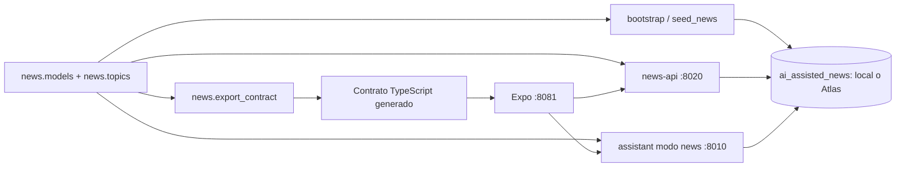

# Contrato compartido de noticias

Estado: implementado. El esquema y los seeders aprobados en el PR #5 (`4228506`),
versionados en `backend/news/` y `docs/design/database/`, son la base común de
la API, el chatbot y el desarrollo local. El PR #4 (`c756e4f`) los consume.

El modo news completa el routing conversacional JEV + CODE + LLM con contratos
deterministas y catálogo de capacidades. El detalle de las rutas, límites y pruebas
está en la [arquitectura conversacional](chatbot-jev-code-llm-pendientes.md).

## Persistencia

Los modelos, las siete colecciones, validators, índices y TTL de DB no se duplican
ni cambian para el chat. `User`, `ChatSession`, `ResponseMetadata` y `AiUsage` se
importan directamente de `news.models`. Las lecturas usan documentos de esas
colecciones y las escrituras pasan por los mismos modelos. Solo se citan noticias
`published`; los cuatro borradores del dataset canónico no se muestran.

API y chat resuelven la conexión con `news.config.get_news_settings`. Local y Atlas
cambian el destino de conexión, no la definición del dominio. El consumidor
asíncrono del chat y el síncrono de la API usan PyMongo.

## Catálogo y contrato HTTP

`news.topics.TOPICS` conserva sus 14 valores y orden. `news.presentation` añade
etiquetas para interfaces sin modificar el catálogo. El clasificador del chat
parte de todos esos valores; `ciencia` y `negocios` conservan su identidad y
`medio_ambiente` se compara con la misma normalización a ambos lados.

`news.export_contract` genera `frontend/src/generated/newsContract.ts` con el
catálogo y tipos de enums compartidos. Ejecutar `make news-contract` después de
cambiar sus fuentes, y `make news-contract-check` para detectar drift. También
pueden ejecutarse sin Docker con `PYTHONPATH=backend python -m news.export_contract`
y su opción `--check`. No requieren DB ni secretos.

El HTTP conserva `topics[]`, `geographicScope`, `verification`, todas las `sources`,
`aiAssistance` y el tipo y declaración de IA de la imagen. Se mantienen `category`,
`body`, `source` y `readingMinutes` por compatibilidad de presentación. Las
referencias ObjectId se convierten a strings; no son un segundo esquema MongoDB.
Los filtros y relacionados utilizan todos los topics. Las citas pueden consultar
`GET /news/{slug}` aunque la noticia no esté entre las últimas 50 del feed.

Los campos topics de persistencia siguen siendo strings libres. No se incorpora
la validación cerrada que `09-catalogos-y-seeders.md` deja pendiente de decisión.

## Consultas del chat a la base compartida

Los conteos consultan la colección `news` completa con filtros estructurados de país y tema.
La respuesta distingue total, publicadas y borradores; únicamente se cita contenido publicado.
El listado por país usa el catálogo `locations`, consulta las cantidades publicadas y presenta
un ejemplo por país con disponibilidad. Una noticia con varios países puede aparecer en varios
grupos. Estos dos casos usan `database_query` sin invocar al modelo, con las mismas intenciones
persistidas existentes (`recent_news`, `regional_news` o `topic_news`). No se agregan enums.

Los listados ordinarios consultan país/tema directamente en MongoDB antes de limitar sus cinco
ejemplos. La ventana reciente de 200 sigue acotando la búsqueda por texto libre; no limita los
conteos ni los filtros estructurados. Las elaboraciones conservan sus límites de contexto.

Para respuestas con IA, el contexto contiene conteos calculados en el turno, el tamaño y alcance
de la selección, topics y `geographicScope` con referencias resueltas a país/código/nombre. Una
referencia sin resolver queda explícita y no se sustituye por la ubicación del usuario. El prompt
`news-v3` distingue muestra y total y prioriza este contexto sobre respuestas anteriores.

El planificador reconstruye los seguimientos con los mensajes ya embebidos en la sesión
vigente. Conserva tema/país y conteos en consultas elípticas y resuelve las referencias
a la selección anterior antes de buscar otra vez. «Ok sí hazlo» llega al proveedor con
la oferta anterior y sus noticias. Una referencia por posición conserva el orden original;
se comprueba nuevamente que el artículo siga publicado. No se cambia el esquema ni el TTL.
El usuario y la vigencia de la sesión se verifican antes de consultar ese historial.

Todo lo anterior es presentación y consulta del consumidor; los documentos MongoDB mantienen
el esquema aprobado y los seeders no se modifican.

## Identidad administrativa

La identidad canónica continúa siendo `local-admin:<username>` y su ObjectId
conserva el algoritmo de `news.api` anterior. Publicación y chat reutilizan ese
usuario. El chat acepta el identificador de transporte `admin:<username>` solo
cuando verifica el mismo Bearer emitido por `/admin/login`. No concede privilegios
por el rol o identificador enviado por el cliente. Se conserva el perfil existente.

No se fusionan ni eliminan usuarios o sesiones antiguos con `admin:<username>`:
una migración de datos previos requiere revisión humana independiente. Google e
invitado mantienen identificadores provisionales hasta implementar autenticación
verificada; este cambio no implementa Firebase.

## Arranque reproducible

En desarrollo, `make db-bootstrap` inicializa el esquema e inserta únicamente los
catálogos y las 32 fixtures canónicas, sin modificar documentos existentes. Luego
`make db-verify` comprueba el resultado. Los seeders no se ejecutan al arrancar
la API ni el chat. `db-seed-demo` sigue disponible como comando legacy explícito,
pero no forma parte del arranque recomendado. No se ejecuta ningún reseed.

`python -m assistant.news_chat.run`, desde `backend/`, carga el `.env` raíz y
selecciona el modo y prompt de noticias, igual que el contenedor `chatbot`.
`assistant.app` conserva los modos históricos si se seleccionan explícitamente.
Los Dockerfiles instalan los requisitos de `news` y el desarrollo monta el mismo
código de dominio en ambos servicios. Después de modificar Python se reinician
ambos procesos; después de cambiar dependencias se reconstruyen ambas imágenes.
