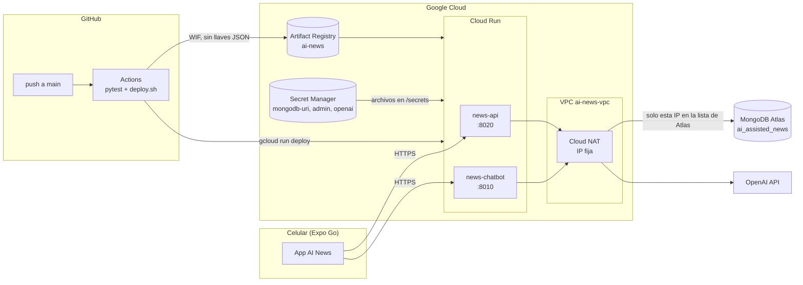

# Deploy en Google Cloud

Estado: v1 (2026-10-19). Despliega `news-api` y el chatbot (`backend/assistant` en modo news) en
Cloud Run. La base sigue en MongoDB Atlas. La app se prueba en celulares con Expo Go apuntando a las
URLs de Cloud Run.

## Infraestructura



## Archivos

| Archivo | Uso |
|---|---|
| `deploy/gcp/config.sh` | Parámetros no secretos: proyecto, región, nombres y precios del modelo. |
| `deploy/gcp/bootstrap.sh` | Crea APIs, Artifact Registry, cuentas de servicio, secretos vacíos, red con IP fija y la federación con GitHub. Idempotente. |
| `deploy/gcp/load-secrets.sh` | Sube `keys/*` a Secret Manager sin imprimir valores. |
| `deploy/gcp/deploy.sh` | Build, push y deploy de los dos servicios. |
| `.github/workflows/deploy.yml` | Pytest en cada PR. Deploy automático en `main`. |

## Seguridad

- Los secretos viven en Secret Manager y se montan como archivos, igual que `keys/` en local.
- Cada servicio corre con su propia cuenta de servicio y solo lee sus secretos. `news-api` no ve la
  key de OpenAI.
- La salida a internet pasa por Cloud NAT con IP fija. Atlas permite solo esa IP.
- GitHub se autentica con Workload Identity Federation, limitado al repo y a la rama `main`.
- La cuenta del pipeline tiene `run.developer`, no `run.admin`: no puede cambiar quién invoca los
  servicios.
- `.dockerignore` excluye `keys/` y cualquier `.env`.
- `MAX_INSTANCES=2` acota el costo. El chat no tiene autenticación todavía: cualquiera con la URL
  puede consumir el presupuesto de IA hasta USD 20. Se cierra cuando exista Firebase Auth.

## Primer deploy

Requisitos: `gcloud`, Docker y una cuenta con rol Owner en el proyecto.

1. Crear el proyecto en <https://console.cloud.google.com/projectcreate> y vincular la facturación.
2. Instalar `gcloud`. En NixOS: `nix shell nixpkgs#google-cloud-sdk`.
3. Iniciar sesión: `gcloud auth login`.
4. Editar `deploy/gcp/config.sh`: `PROJECT_ID`, `REGION` y los precios `NEWS_CHAT_*`.
5. `make gcp-bootstrap`. Al final imprime la IP fija y los valores para el workflow.
6. En Atlas, Network Access: agregar `<IP>/32`.
7. `make gcp-secrets`.
8. `ALLOW_PUBLIC=1 make gcp-deploy`. Imprime las dos URLs.
9. En `.github/workflows/deploy.yml`, reemplazar `WIF_PROVIDER` y `DEPLOYER_SA`.

Desde ahí cada merge a `main` despliega solo.

## Probar en celulares

En `frontend/.env` (Expo lo lee al iniciar `npx expo start` fuera de Docker):

```dotenv
EXPO_PUBLIC_NEWS_API_BASE_URL=https://news-api-xxxx.run.app
EXPO_PUBLIC_ASSISTANT_API_BASE_URL=https://news-chatbot-xxxx.run.app
```

Después `cd frontend && npx expo start --tunnel` y escanear el QR con Expo Go. Con `--tunnel` los
celulares no necesitan estar en la misma red.

## Cambiar un secreto

Editar el archivo en `keys/`, correr `make gcp-secrets` y volver a desplegar (`make gcp-deploy` o un
merge a `main`). Cloud Run toma la versión `latest` en cada revisión nueva.
